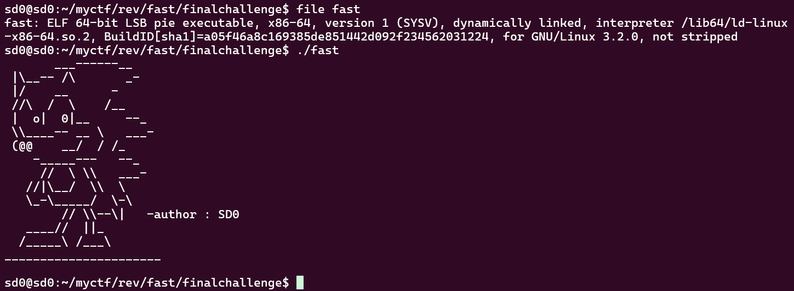
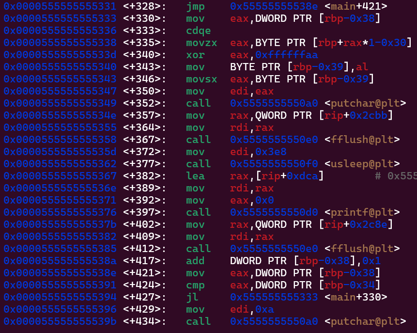

# fast - Reverse Engineering Challenge

## Challenge Information
- **Event:** Securinets ISET Zaghouan x D6ATH E9TERS
- **Category:** Reverse Engineering
- **Difficulty:** Easy
- **Author:** SD0
- **Description:** "Think you can read that fast? Think again."

## Overview
This challenge presents an ELF binary that displays the flag character by character, but deletes each character too quickly for the human eye to read. The goal is to use debugging techniques to pause the execution at the right moment to capture the flag.

## Purpose & Learning Objectives
- **Debugger Fundamentals:** How to use GDB for basic control flow manipulation
- **Timing Analysis:** Recognizing how programs use sleep/delay functions
- **Strategic Breakpoints:** Learning to pause execution at critical moments
- **Program Behavior Observation:** Understanding that sometimes the solution is visible if you just slow things down

## Initial Analysis
When running the binary, the flag characters appear and disappear at a speed that makes it impossible for humans to read. This indicates the program is using some form of timing function (like `usleep()`) between displaying and erasing characters.



## Tools Used
- **GDB (GNU Debugger)** - For setting breakpoints and analyzing program execution
- **disassembler** - To understand the program's logic flow

## Solution Walkthrough

### Step 1: Understanding the Program Flow
First, I ran the program to observe its behavior. As expected, it displayed characters too quickly to read. This suggested the program:
1. Displays a character
2. Waits (using a sleep function)
3. Erases the character
4. Repeats for each character

### Step 2: Disassembling the Binary
I disassembled the binary using GDB to locate the main function and understand the program's logic. The key was finding where the program handles the timing.

```bash
gdb ./fast
(gdb) disass main
```



After analyzing the disassembly, I identified the critical instructions:

```asm
0x0000000000001349 <+352>:   call   0x10a0 <putchar@plt>
0x000000000000134e <+357>:   mov    rax,QWORD PTR [rip+0x2cbb]
0x0000000000001355 <+364>:   mov    rdi,rax
0x0000000000001358 <+367>:   call   0x10e0 <fflush@plt>
0x000000000000135d <+372>:   mov    edi,0x3e8
0x0000000000001362 <+377>:   call   0x10f0 <usleep@plt>    ← KEY INSTRUCTION
0x0000000000001367 <+382>:   lea    rax,[rip+0xdca]
0x000000000000136e <+389>:   mov    rdi,rax
0x0000000000001371 <+392>:   mov    eax,0x0
0x0000000000001376 <+397>:   call   0x10d0 <printf@plt>
```

The critical point is at address `0x0000000000001362` where `usleep@plt` is called. This is where the program pauses between displaying and erasing characters.

### Step 3: Setting a Strategic Breakpoint
By setting a breakpoint at the `usleep` call, we can pause the program repeatedly after each character is displayed but before it gets erased.

**Solution Steps:**

```bash
gdb ./fast

# Step 1: Disassemble main to find addresses
(gdb) disass main

# Step 2: Break at main to start
(gdb) break main

# Step 3: Run the program
(gdb) run

# Step 4: Set breakpoint at the usleep call
(gdb) b*0x0000000000001362

# Step 5: Continue execution - flag displays letter by letter
(gdb) c
```

Each time you hit `c` (continue), the program will:
1. Display one character
2. Pause at the breakpoint (before usleep)
3. Wait for you to continue

This allows you to read each character of the flag at your own pace!

## Key Takeaways
This challenge teaches that when a program operates too fast for manual observation, debuggers give us the power to slow down or pause execution at critical moments. The solution isn't about breaking complex cryptography or reversing obfuscated code — it's about understanding program flow and using basic debugging techniques effectively.

**Remember:** Sometimes the best reverse engineering solution is simply to pause and observe.
