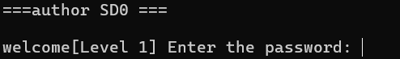
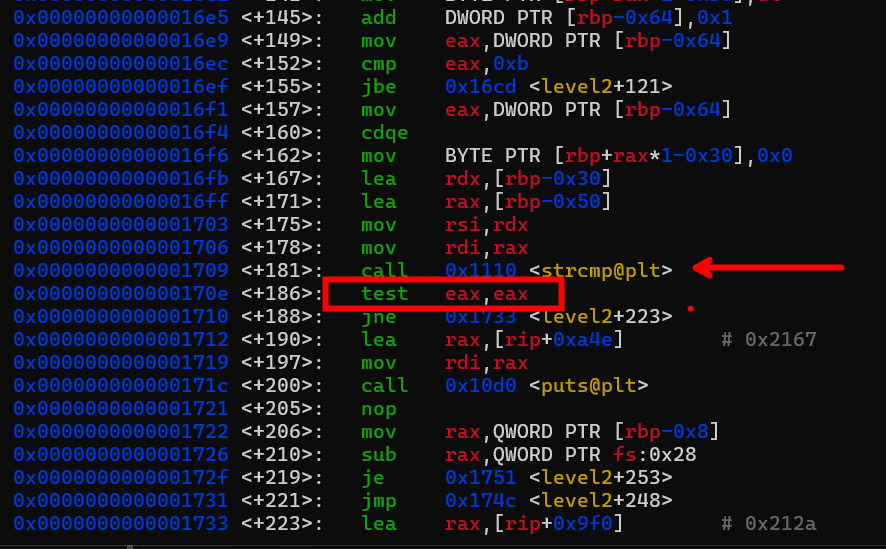
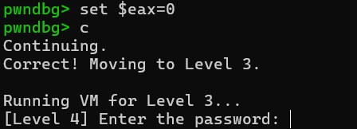
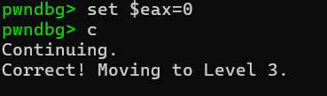

# Grandma's Security System - Multi-Layer VM Challenge

## Challenge Information
- **Event:** Securinets ISET Zaghouan x D6ATH E9TERS
- **Category:** Reverse Engineering
- **Difficulty:** Medium-Hard
- **Points:** 300
- **Author:** SD0
- **Description:** Someone told Grandma her house needed better security, so she built a four-layer virtual machine using a YouTube tutorial and a lot of confusion. Now, no one can get in — not even her.

## Overview
This challenge introduces players to virtual machine reverse engineering through a progressive, four-layer security system. Each layer increases in complexity, teaching different VM concepts and bypass techniques. The challenge demonstrates how custom instruction sets and virtual CPUs are used for protection in modern malware and software.

## Purpose & Learning Objectives
- **VM Architecture Analysis:** Understanding custom instruction sets and virtual CPUs
- **Layer-by-Layer Analysis:** Tackling complex systems by breaking them into manageable parts
- **Runtime Manipulation:** Using debuggers to bypass VM protections  
- **Hash Function Bypass:** Dealing with cryptographic checks without reversing the algorithm
- **Progressive Difficulty:** Building skills through increasingly complex layers



## Layer Breakdown

This challenge has 4 layers progressing from easy to hard:
1. **Layer 1:** Plaintext string comparison (teaches basic reconnaissance)
2. **Layer 2:** Runtime decryption (introduces dynamic analysis and strcmp bypass)
3. **Layer 3:** Simple VM (introduces virtual machine concepts)
4. **Layer 4:** Complex VM with crypto (teaches hash function bypass)

---

## Layer 1: The Warmup — String Comparison

### Analysis
The first layer uses a simple string comparison — the most basic form of authentication.

```bash
strings ./game
```

Looking through the output, we see `PasSWORD` which looks suspicious. That's the password for level 1!

### Solution
```bash
./game
# When prompted for Layer 1 password:
PasSWORD
```

### Why It Works
The binary contains the password in plaintext, making it vulnerable to basic string analysis. This teaches players to always check for low-hanging fruit first.

---

## Layer 2: Obfuscated String Comparison

### Analysis
This layer decrypts the string at runtime rather than storing it in plaintext. The `strcmp` function is used, but we can manipulate the comparison result.



We know that `strcmp` returns 0 if the two strings are equal. Looking at the disassembly, we see the return value is tested in the `eax` register. If we can change the value of `eax` to 0 at that address, we can bypass the strcmp check!

### Solution with GDB

```bash
gdb ./game

# Disassemble level2 to get the address of the strcmp test
(gdb) disass level2

# Break at the test instruction after strcmp
(gdb) b *0x000000000000170e

# Run until we hit the breakpoint
(gdb) run
# Enter Layer 1 password first (PasSWORD)
# Enter any string for Layer 2

# When breakpoint hits, force eax to 0 (strcmp success)
(gdb) set $eax = 0

# Continue execution
(gdb) c
```

### Key Insight
We don't need to know the correct password if we can manipulate the comparison result directly. This teaches dynamic analysis and register manipulation.

---

## Layer 3: Simple Virtual Machine

### Analysis
This layer implements a basic VM with its own instruction set:

- **OP_MOV:** Move immediate value to register
- **OP_ADD:** Add values
- **OP_CMP:** Compare register with immediate
- **OP_JEQ:** Jump if equal
- **OP_EXIT:** Terminate execution



The VM program looks like this:

```c
OP_MOV, 0, 5       // reg[0] = 5
OP_ADD, 0, 3       // reg[0] = reg[0] + 3 → reg[0] = 8
OP_CMP, 0, 8       // Compare reg[0] == 8
OP_JEQ, 12         // If equal, jump to success code
OP_EXIT, 0         // Otherwise, exit with failure
```

### Solution: VM Register Manipulation

The virtual machine uses a register file stored at a fixed memory location. We need `reg[0]` to equal 8 to pass. Through debugging, we can find the memory address where the VM registers are stored.

```bash
gdb ./game

# Break at the VM execution point
(gdb) break level3

# Run and pass layers 1 and 2
(gdb) run

# Find the VM register location and set reg[0] = 8
(gdb) set {int}0x7fffffffe1b0 = 8

# Continue
(gdb) c
```



### Key Insight
By understanding the VM's memory layout, we can directly manipulate virtual registers without executing the VM instructions. This teaches players to think beyond the abstraction layer.

---

## Layer 4: Advanced VM with Hash Verification

### Analysis
The final layer implements a more sophisticated VM that includes a hash function. The VM calculates a hash of our input and compares it against a hardcoded value `0x12345678`.


Instead of reversing the complex hash function (which could take hours), we can simply set the result register (`EAX`) to the expected value **after** the hash computation but **before** the verification check.

### Solution: Hash Bypass

```bash
gdb ./game

# Break after the hash function call but before comparison
(gdb) break *0x0000555555555b3b

# Run and pass all previous layers
(gdb) run

# When breakpoint hits, force the hash result
(gdb) set $eax=0x12345678

# Continue to victory!
(gdb) continue
```

### Key Insight
When faced with complex cryptographic functions, sometimes the best solution is to bypass them entirely rather than trying to reverse them. This teaches practical reverse engineering efficiency.

---

## Flag

```
Securinets{G00d_VM3_1RE_N0T_H4RD_010110}
```

## Complete Playthrough Summary

**Layer 1:** `strings` → Find `PasSWORD`  
**Layer 2:** GDB → `set $eax = 0` at strcmp test  
**Layer 3:** GDB → `set {int}0x7fffffffe1b0 = 8`  
**Layer 4:** GDB → `set $eax = 0x12345678` after hash function

## Key Takeaways

This challenge emphasizes the **educational journey** through progressively complex protection mechanisms. Each layer builds on the previous one:

1. **Static Analysis** (Layer 1) → Always check the easy stuff first
2. **Dynamic Analysis** (Layer 2) → Manipulate program state at runtime
3. **VM Understanding** (Layer 3) → Think beyond the abstraction
4. **Smart Bypassing** (Layer 4) → Efficiency over brute force

The challenge shows players multiple approaches to tackle virtual machine-based challenges — from simple debugging to sophisticated runtime manipulation. Most importantly, it teaches that **understanding the goal** is often more important than understanding every detail of the implementation.

**Remember:** Grandma's security might be confusing, but with patience and the right tools, any protection can be understood and bypassed!
