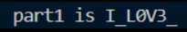
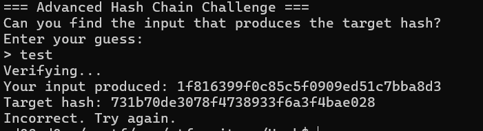
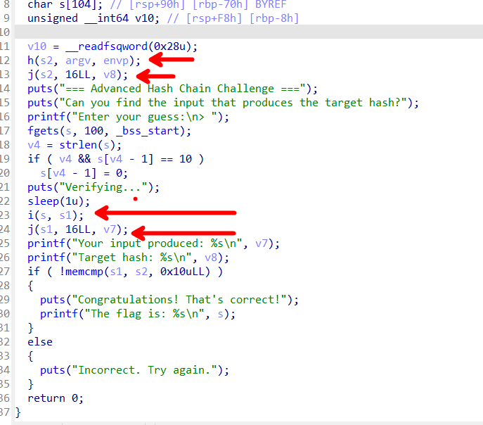
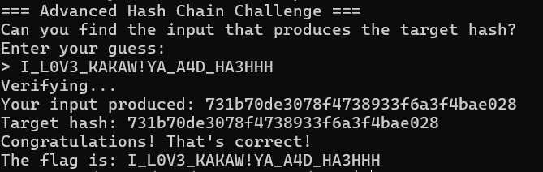

# Grandma's Hash Fortress - Hash Chain Reversal Challenge

## Challenge Information
- **Event:** Securinets ISET Zaghouan x D6ATH E9TERS
- **Category:** Reverse Engineering
- **Difficulty:** Hard
- **Points:** 500
- **Author:** SD0
- **Description:** After locking herself out of her own VM, Grandma built a hash chain so long it might legally be a blockchain. Every input goes through layers of mystery meat hashing, salted with chaos and YouTube wisdom. Reverse the mess one link at a time — and remember: Grandma doesn't believe in comments or mercy.

## Overview
This challenge teaches comprehensive binary analysis and the importance of extracting all available information before attempting complex attacks. The binary validates input against an MD5 hash, but the real challenge isn't breaking MD5 — it's finding the hidden pieces of the flag through careful reverse engineering.

## Purpose & Learning Objectives
- **Information Gathering:** Extracting every possible clue from the binary before attacking the main problem
- **Progressive Analysis:** Building understanding layer by layer rather than jumping to the hardest part
- **Targeted Brute Forcing:** Using cryptographic attacks only when necessary and with precise constraints
- **Code Path Analysis:** Understanding which functions are actually used versus which are decoys
- **String Reconstruction:** Piecing together obfuscated or encrypted strings to build the complete picture

## Initial Analysis

### The Cryptographic Trap
When you first run the binary, you see a prompt asking for input and a target MD5 hash prominently displayed:



Many players immediately think: **"I need to break MD5!"** This is the red herring. MD5 collisions are computationally expensive and unnecessary.

## Phase 1: The False Assumption

The binary displays:
```
Target MD5: e5bd0bfcb03d8f33fdc945852309fbed
Enter your guess:
```

This is designed to trigger the "I need to break MD5" instinct. **Don't fall for it!** The challenge teaches players to resist their first impulse and look for easier paths.

---

## Phase 2: Comprehensive Binary Analysis

### Step 1: Function Analysis
Using Ghidra or IDA Pro, analyze all functions in the binary. You'll notice many complex-looking functions that appear to "do nothing" — these are decoys!



**The Decoy Functions serve two purposes:**
1. They train players to distinguish between relevant and irrelevant code
2. They hide the actual string pieces in plain sight through basic obfuscation

### Step 2: String Extraction and Reconstruction
Through both **dynamic analysis** (debugging) and **static analysis**, we can recover partial strings scattered throughout the binary:

- **Part 1:** `I_L0V3_`
- **Part 2:** `KAKA*!**` (with 3 unknown characters marked as `*`)  
- **Part 3:** `_A4D_HA3HHH`



### Step 3: Understanding the Flag Structure
Combining the recovered pieces:

```
I_L0V3_KAKA*!**_A4D_HA3HHH
            ^^^
         3 unknown bytes
```

The complete flag appears to follow the pattern:
```
I_L0V3_KAKA[X]![Y][Z]_A4D_HA3HHH
```

Where `[X]`, `[Y]`, and `[Z]` are unknown uppercase letters.

---

## Phase 3: Strategic Brute Force

### Step 4: The Mathematical Reality

Now that we've extracted most of the flag through analysis, we only need to brute force **3 unknown characters**:

- Total possibilities: **95 printable characters³ = 857,375 combinations**
- With uppercase letters only: **26³ = 17,576 combinations**
- This is computationally **feasible** (seconds to minutes on modern hardware)

### Step 5: Python Brute Force Script

```python
import hashlib
import itertools
import string

target_md5 = "e5bd0bfcb03d8f33fdc945852309fbed"
prefix = "I_L0V3_KAKA"
suffix = "_A4D_HA3HHH"

# Try all uppercase letter combinations for the 3 unknown positions
for chars in itertools.product(string.ascii_uppercase, repeat=3):
    # Build candidate: I_L0V3_KAKA[X]![Y][Z]_A4D_HA3HHH
    candidate = f"{prefix}{chars[0]}!{chars[1]}{chars[2]}{suffix}"
    
    # Calculate MD5
    md5_hash = hashlib.md5(candidate.encode()).hexdigest()
    
    # Check if it matches
    if md5_hash == target_md5:
        print(f"Found: {candidate}")
        print(f"MD5: {md5_hash}")
        break
else:
    print("No solution found in uppercase range")
```

### Step 6: The Solution

Running the script:

```
Found: I_L0V3_KAKAW!YA_A4D_HA3HHH
MD5: e5bd0bfcb03d8f33fdc945852309fbed
```



---

## Phase 4: Verification

Test the solution against the binary:

```bash
./hash
Target MD5: e5bd0bfcb03d8f33fdc945852309fbed
Enter your guess: I_L0V3_KAKAW!YA_A4D_HA3HHH
✓ Correct! Flag accepted.
```

## Flag

```
Securinets{I_L0V3_KAKAW!YA_A4D_HA3HHH}
```

---

## Behind the Scenes: Creator's Notes

### The Psychological Design
The target hash is prominently displayed to trigger the "I need to break MD5" instinct. This teaches players to resist their first impulse and look for easier paths.

### The Three Unknown Bytes
Three bytes were chosen specifically because:
- It's **small enough** to be brute-forceable
- It's **large enough** to make blind guessing impractical (17,576+ combinations)
- It **forces players** to do the binary analysis first

### The Decoy Functions
The numerous complex-looking functions that "do nothing" serve a dual purpose:
1. Train players to identify relevant vs irrelevant code
2. Slow down automated tools and encourage manual analysis

---

## Key Takeaways

This challenge emphasizes that **information gathering beats brute force**. The "aha!" moment comes when players realize:

1. **You don't need to break MD5** — you need to extract information from the binary
2. **Partial information is powerful** — reducing the search space from 95²⁴ to 26³ makes the impossible possible
3. **Combine techniques** — static analysis + dynamic analysis + minimal brute force = efficient solution
4. **Resist first instincts** — the obvious approach (break MD5) is almost never the right one

**Remember:** The best reverse engineers don't just break things — they extract every piece of information before deciding what (if anything) needs to be broken.
