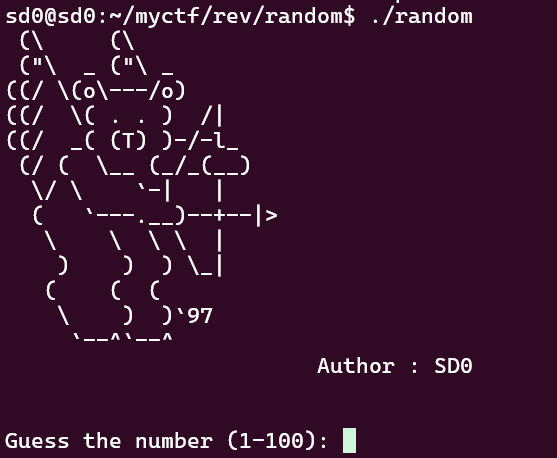
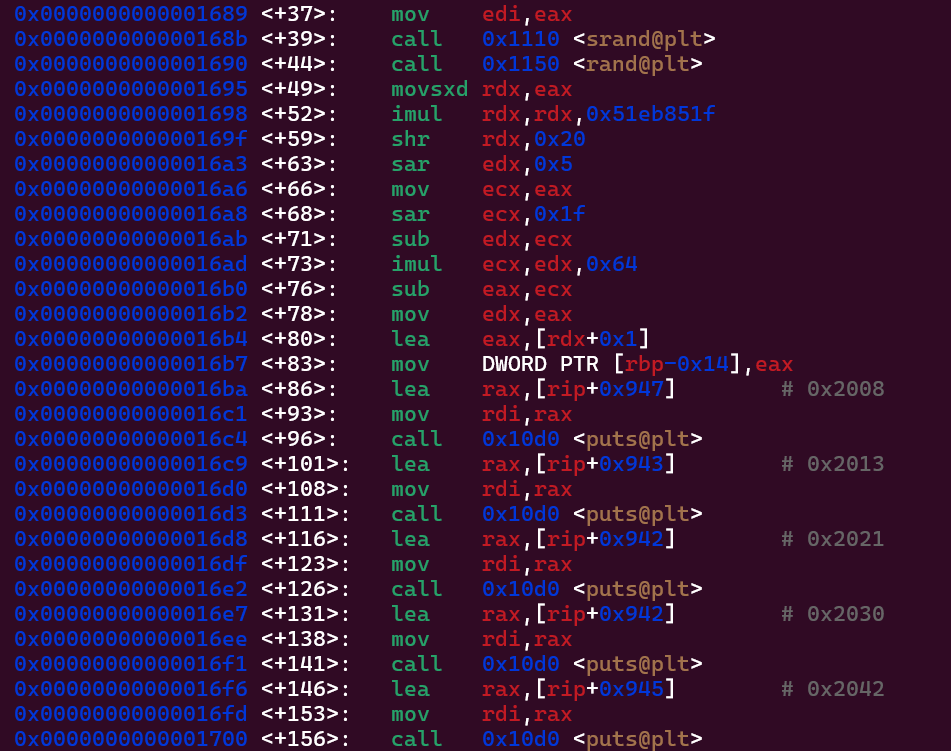
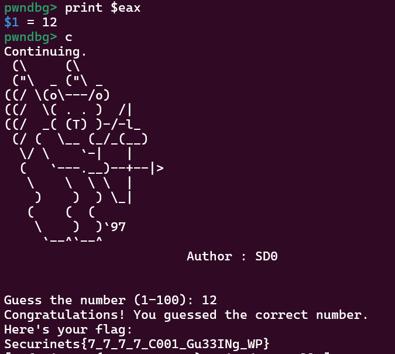

# random - Reverse Engineering Challenge

## Challenge Information
- **Event:** Securinets ISET Zaghouan x D6ATH E9TERS
- **Category:** Reverse Engineering
- **Difficulty:** Easy
- **Author:** SD0
- **Description:** Guess the number between 1-100. Or better yet, just read it from the CPU.

## Overview
This challenge presents a colorful number guessing game that appears to generate a random number each time. The binary prompts you to guess a number between 1-100, but brute force is impractical. The key insight is that in reverse engineering, you don't need to predict random numbers — you can just read them from memory or registers.

## Purpose & Learning Objectives
- **Register Analysis:** Understanding how to inspect CPU registers during execution
- **Memory vs Random:** Recognizing that "random" numbers are deterministic in programs
- **Strategic Breakpoints:** Learning to break at the right moment in program execution
- **Dynamic Analysis:** Using debuggers to extract runtime values rather than predicting them

## Initial Analysis

### Step 1: Understanding the Program Flow
When you run the binary, you see colorful ASCII art and a prompt to guess a number between 1-100. The program seems to generate a random number each time, making brute force impractical.



The key insight is that the random number is generated and **stored BEFORE** the user input is compared.

### Step 2: Finding the Critical Moment
Through binary analysis, we need to identify where:
1. The random number has been generated
2. It's stored in memory
3. But it hasn't been compared to our input yet



## Solution Walkthrough

### Step 3: Strategic Breakpoint Placement
The magic happens at `main+86`. By this point:
- The random number has been generated (using `rand()`)
- It's been stored in memory at `[rbp-0x14]` or `[rbp-0xc]` depending on the implementation
- The original value is **still sitting in the EAX register**
- The program hasn't yet compared it to user input



### Step 4: The GDB Solution

```bash
gdb ./random

# Set breakpoint right after number generation
(gdb) break *main+86

# Run the program
(gdb) run
```

When the breakpoint hits, the random number is conveniently sitting in the `EAX` register:

```bash
# Read the "random" number directly from the register
(gdb) print $eax
$1 = 86

# Continue execution
(gdb) continue
```

Now simply enter the number you just read:

```
Guess the number (1-100): 86
Congratulations! You guessed the correct number.
```

### Why This Works

**After Number Storage:**
The instruction at `main+83` stores the final number (in `EAX`) into memory (`[rbp-0xc]`). By breaking at `main+86`, we ensure this store operation has **already completed**, but the comparison with our input hasn't happened yet.

This gives us a perfect window to:
1. Read the value from `$eax`
2. Input the exact same value
3. Win every time

## Key Takeaways
This challenge teaches a fundamental principle of reverse engineering: **you don't need to predict or brute force what you can simply observe**. 

The "aha!" moment comes when players realize they're not guessing — they're just reading what's already been computed.

**Remember:** In reverse engineering, if the program knows the answer, you can know it too. The debugger is your window into the program's "thoughts."
