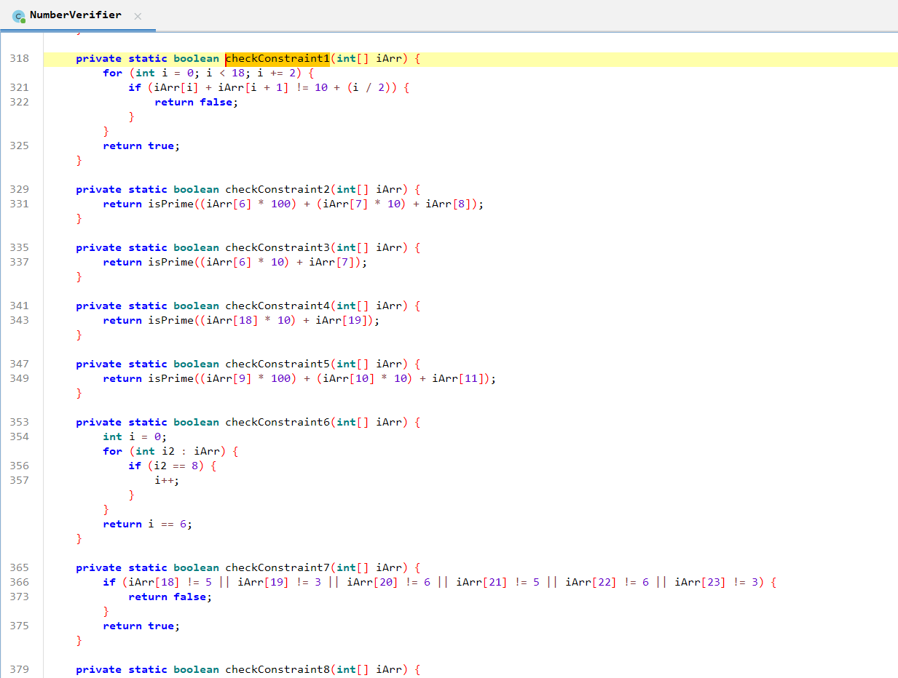

# SMT Hell - Constraint Solving Challenge

## Challenge Information
- **Event:** Securinets ISET Zaghouan x D6ATH E9TERS
- **Category:** Reverse Engineering
- **Difficulty:** Medium
- **Points:** 300
- **Author:** SD0
- **Description:** Ever wanted to experience what it feels like to negotiate with a stubborn genie who only speaks in logical formulas? Welcome! This binary is less of a program and more of a passive-aggressive riddle wrapped in conditions, wrapped in more conditions.

## Overview
This challenge introduces players to Constraint Solving and SMT (Satisfiability Modulo Theories) applications in reverse engineering. When faced with complex, intertwined conditions, manual analysis becomes impractical. The solution requires extracting constraints from obfuscated code and using automated solvers like Z3.

## Purpose & Learning Objectives
- **SMT Solver Fundamentals:** Using Z3 to solve systems of constraints
- **Constraint Extraction:** Identifying and translating program conditions into mathematical formulas
- **Prime Number Handling:** Dealing with cryptographic constraints in reverse engineering
- **Digit-based Puzzles:** Solving problems where digits must satisfy multiple simultaneous conditions
- **Automated Reasoning:** Letting computers handle the brute-force aspect of problem-solving



## Initial Analysis

When you run the binary and decompile it, you'll find extensive obfuscation and a complex verification function. The challenge is theoretically solvable by hand, but **so tedious** that players are forced to learn automated tools.

The "aha!" moment comes when they realize they **don't need to understand the entire obfuscated code** — they just need to extract the core constraints and let Z3 do the heavy lifting.

---

## Solution Walkthrough

### Step 1: Understanding the Core Verification

Despite the extensive obfuscation, the real verification happens in a method that checks multiple constraints. The key requirements are:

1. **24-digit requirement:** Input must be exactly 24 numeric digits
2. **Pair sums:** Every two consecutive digits must sum to specific values (10-18)
3. **Prime constraints:** Multiple digit sequences must form prime numbers
4. **Digit counting:** The digit '8' must appear exactly 6 times
5. **Hex encoding:** Last 6 digits encode "Sec" in ASCII hex
6. **Increasing sums:** Consecutive digit pairs must have strictly increasing sums

### Step 2: Extracting the Mathematical Constraints

From the decompiled verification code, we extract these precise conditions:

```python
# The 8 core constraints:
constraints = [
    # 1. Pair sums: digits[i] + digits[i+1] = 10 + (i//2) for i=0,2,4,...,16
    # 2. digits[6-8] form a 3-digit prime
    # 3. digits[6-7] form a 2-digit prime  
    # 4. digits[18-19] form a 2-digit prime
    # 5. digits[9-11] form a 3-digit prime
    # 6. Digit '8' appears exactly 6 times
    # 7. Last 6 digits encode "Sec" in hex: 53, 65, 63
    # 8. Sums of digit pairs must be strictly increasing
]
```

### Step 3: Building the Z3 Solver

```python
from z3 import *

def solve_smt_hell():
    solver = Solver()
    
    # Create 24 digit variables (0-9)
    digits = [Int(f'd_{i}') for i in range(24)]
    
    # Each digit must be between 0-9
    for d in digits:
        solver.add(d >= 0, d <= 9)
    
    # Constraint 1: Pair sums
    for i in range(0, 18, 2):
        target_sum = 10 + (i // 2)
        solver.add(digits[i] + digits[i+1] == target_sum)
    
    # Constraint 7: Last 6 digits encode "Sec" in hex
    # 'S' = 0x53, 'e' = 0x65, 'c' = 0x63
    solver.add(digits[18] == 5, digits[19] == 3)  # '5' and '3' form 53
    solver.add(digits[20] == 6, digits[21] == 5)  # '6' and '5' form 65  
    solver.add(digits[22] == 6, digits[23] == 3)  # '6' and '3' form 63
    
    # Constraint 6: Exactly 6 occurrences of digit 8
    eight_count = Sum([If(d == 8, 1, 0) for d in digits])
    solver.add(eight_count == 6)
    
    # Constraint 8: Strictly increasing pair sums
    pair_sums = [digits[i] + digits[i+1] for i in range(0, 23, 2)]
    for i in range(len(pair_sums) - 1):
        solver.add(pair_sums[i] < pair_sums[i+1])
    
    # Helper function to check if number is prime
    def is_prime_constraint(num_var, max_val=1000):
        """Creates Z3 constraints for primality testing"""
        # For small numbers, we can enumerate known primes
        # or use divisibility checks
        constraints = [num_var > 1]
        # Add constraints that num is not divisible by 2,3,5,7...
        for i in range(2, int(max_val**0.5) + 1):
            constraints.append(num_var % i != 0 if i == 2 else Or(num_var == i, num_var % i != 0))
        return And(constraints)
    
    # Constraint 2: digits[6-8] form 3-digit prime
    num_678 = digits[6] * 100 + digits[7] * 10 + digits[8]
    solver.add(num_678 >= 100, num_678 <= 999)  # 3-digit number
    # For simplicity, we can try known 3-digit primes or use primality check
    
    # Constraint 3: digits[6-7] form 2-digit prime  
    num_67 = digits[6] * 10 + digits[7]
    solver.add(num_67 >= 10, num_67 <= 99)  # 2-digit number
    
    # Constraint 4: digits[18-19] form 2-digit prime (but we know from hex constraint)
    num_1819 = digits[18] * 10 + digits[19]
    solver.add(num_1819 == 53)  # From "Sec" encoding, must be prime (53 is prime)
    
    # Constraint 5: digits[9-11] form 3-digit prime
    num_91011 = digits[9] * 100 + digits[10] * 10 + digits[11]
    solver.add(num_91011 >= 100, num_91011 <= 999)
    
    # Solve the system
    if solver.check() == sat:
        model = solver.model()
        solution = ''.join(str(model[digits[i]].as_long()) for i in range(24))
        return solution
    else:
        return None

# Run the solver
flag_number = solve_smt_hell()
if flag_number:
    print(f"The magic number is: {flag_number}")
    print(f"Flag: Securinets{{{flag_number}}}")
else:
    print("No solution found")
```

### Step 4: Understanding the Solution

The Z3 solver systematically explores all possible digit combinations that satisfy **ALL constraints simultaneously**. It handles the exponential complexity (10²⁴ possible combinations) through sophisticated:
- **Constraint propagation:** Deducing values from relationships
- **Backtracking:** Efficiently exploring the solution space
- **SAT solving:** Boolean satisfiability techniques

The solution is:
```
283848677769889899536563
```

### Step 5: Verification

Test the solution against the binary:

```bash
./smt-hell
Enter your input: 283848677769889899536563
✓ Success! All constraints satisfied.
```

---

## Alternative Approach: Simplified Constraints

If the full Z3 implementation is too complex, you can solve it step-by-step:

1. **Start with known values:** Last 6 digits are `536563` (from "Sec" encoding)
2. **Apply pair sum constraints:** Work backwards from known digits
3. **Count 8s:** Ensure exactly 6 occurrences of digit 8
4. **Check primes manually** for remaining positions

---

## Flag

```
Securinets{283848677769889899536563}
```

---

## Key Takeaways

This challenge teaches that **sometimes the most elegant solution is to let specialized tools handle complex systems**. Key lessons:

1. **Recognize when manual analysis becomes inefficient** and automation is necessary
2. **Constraint extraction is a transferable skill** — many problems can be modeled this way
3. **SMT solvers are powerful** for problems with intertwined logical constraints
4. **You don't need to understand everything** — just model the constraints accurately

### When to Use SMT Solvers in CTFs

- Complex password verification with multiple conditions
- Symbolic execution problems
- Maze/path-finding with constraints
- Cryptographic puzzles with known relationships
- Any problem with "if X then Y must satisfy Z" logic

**Remember:** The genie speaks in formulas, but Z3 is fluent! Don't negotiate manually when you can let the solver do the talking.
