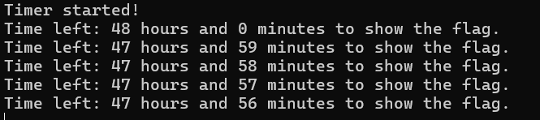
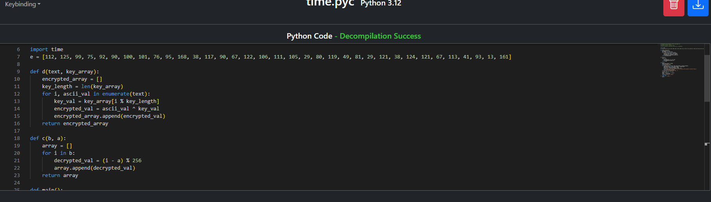
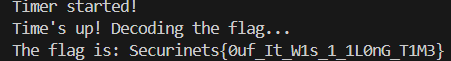

# Don't Close Me - Python Bytecode Reverse Engineering Challenge

## Challenge Information
- **Event:** Securinets ISET Zaghouan x D6ATH E9TERS
- **Category:** Reverse Engineering
- **Difficulty:** Easy
- **Author:** SD0
- **Description:** A Python bytecode challenge with a 48-hour timer. Can you wait that long, or will you find a smarter way?

## Overview
This challenge introduces players to Python reverse engineering and bytecode manipulation. Many CTF players are comfortable with native binaries but struggle when faced with compiled Python or other interpreted languages. The challenge presents a `.pyc` file with a frustratingly long timer that motivates players to explore bytecode decompilation.

## Purpose & Learning Objectives
- **PyC Analysis:** Understanding Python compiled bytecode structure
- **Decompilation Tools:** Using online and offline tools to recover source code
- **Code Modification:** Learning to patch high-level logic rather than assembly
- **Condition Bypass:** Strategic removal of unnecessary checks
- **Python Internals:** How Python executes compiled bytecode

## Initial Analysis

When you run the challenge, you're greeted with a timer that counts down for **48 hours** (172,800 seconds) before revealing the flag:



The 48-hour timer creates immediate frustration that motivates players to look deeper. The "aha!" moment comes when they realize they don't need to wait — they can just read and modify the source code directly.

**Key Insight:** This challenge bridges the gap between native reverse engineering and higher-level language analysis.

---

## Solution Walkthrough

### Step 1: Identifying the File Type

```bash
file time.pyc
```

Output:
```
time.pyc: Byte-compiled Python module for CPython 3.12 or newer, timestamp-based, 
.py timestamp: Wed May  7 21:55:48 2025 UTC, .py size: 1407 bytes
```

This confirms we're dealing with **compiled Python bytecode** (`.pyc` file), not a native binary. This means the source code can likely be recovered!

### Step 2: Decompilation Process

Python bytecode is much easier to reverse than native assembly because it preserves high-level constructs. We can use online decompilers or offline tools:

**Option A: Online Decompiler**
- Visit https://pylingual.io
- Upload `time.pyc`
- Download the decompiled source code



**Option B: Offline Tools**
```bash
# Install uncompyle6 or pycdc
pip install uncompyle6

# Decompile the bytecode
uncompyle6 time.pyc > time_decompiled.py
```

### Step 3: Analyzing the Recovered Source Code

The decompiled code reveals the program logic:

```python
import time

def main():
    total_time_seconds = 172800  # 48 hours!
    interval_seconds = 60
    print('Timer started!')
    
    for elapsed_time in range(0, total_time_seconds, interval_seconds):
        time_left_seconds = total_time_seconds - elapsed_time
        hours_left = time_left_seconds // 3600
        minutes_left = time_left_seconds % 3600 // 60
        print(f'Time left: {hours_left} hours and {minutes_left} minutes to show the flag.')
        time.sleep(interval_seconds)
    
    print("Time's up! Decoding the flag...")
    x = d(e, [42, 17, 9, 55, 37])
    result = c(x, 7)
    flag = [chr(i) for i in result]
    flag = ''.join(flag)
    print(f'The flag is: {flag}')
    return None

if __name__ == '__main__':
    main()
```

**Analysis:**
- The timer is purely cosmetic — it doesn't affect the flag generation
- The flag is generated by functions `d()` and `c()` with hardcoded parameters
- We can simply remove the timer and get the flag immediately!

### Step 4: Bypassing the Timer

We have two simple approaches:

#### **Option A: Remove Timer Completely** (Recommended)

Edit the decompiled code to skip the timer:

```python
def main():
    # Skip all the timer code!
    print("Time's up! Decoding the flag...")
    x = d(e, [42, 17, 9, 55, 37])
    result = c(x, 7)
    flag = [chr(i) for i in result]
    flag = ''.join(flag)
    print(f'The flag is: {flag}')
    return None

if __name__ == '__main__':
    main()
```

#### **Option B: Set Timer to Zero**

Modify the timer values:

```python
def main():
    total_time_seconds = 0      # Changed from 172800
    interval_seconds = 1         # Changed from 60
    # Rest of code remains the same
```

### Step 5: Running the Modified Code

Save your modified Python file and run it:

```bash
python time_decompiled.py
```



The flag is displayed immediately!

---

## Alternative Approach: Direct Bytecode Execution

For advanced players, you can also manipulate the bytecode directly without fully decompiling:

```python
import marshal
import types

# Read the .pyc file
with open('time.pyc', 'rb') as f:
    f.read(16)  # Skip header (varies by Python version)
    code = marshal.load(f)

# Create a modified namespace
namespace = {'__name__': '__main__'}

# Execute just the flag generation parts
# (requires understanding the bytecode structure)
```

---

## Key Takeaways

This challenge teaches several important lessons:

1. **Compiled ≠ Secure:** Python bytecode preserves almost all source-level information
2. **Higher-Level Languages Are Different:** Unlike native binaries, decompiling Python is straightforward
3. **Source Code Access = Ultimate Control:** Once you have the source, you control the logic
4. **Check Assumptions:** The timer seems necessary but is actually just decoration
5. **Cross-Platform Skills:** Reverse engineering isn't just about assembly — scripting languages matter too

### What This Challenge Teaches

- **Python bytecode structure** and how it differs from native compilation
- **When to use decompilation tools** vs manual analysis
- **Logical analysis** of recovered source code
- **Code modification techniques** for bypassing unwanted logic
- **The difference** between compiled and interpreted language reverse engineering

**Remember:** When you have the source code (or can recover it), you have ultimate control. Python bytecode is designed for portability and execution, not security or obfuscation!

---

## Tools Reference

- **Online Decompilers:**
  - https://pylingual.io (supports multiple Python versions)
  - https://www.decompiler.com/ (multi-language)

- **Offline Tools:**
  - `uncompyle6` - Python decompiler (older versions)
  - `pycdc` - Cross-version Python decompiler
  - `decompyle3` - Python 3.7+ decompiler

- **Bytecode Analysis:**
  - `dis` module - Python's built-in disassembler
  - `marshal` module - For loading bytecode

---

## Creator's Notes

The 48-hour timer was specifically chosen to create immediate frustration. Most players' first reaction is "No way I'm waiting 48 hours!" which motivates them to look for alternatives. This emotional response drives the learning process.

The challenge bridges an important gap: many reverse engineers focus exclusively on native binaries (C/C++, assembly) and overlook higher-level languages. Modern malware and CTF challenges increasingly use Python, JavaScript, and other interpreted languages, making these skills essential.

**The "aha!" moment:** Realizing that Python's `.pyc` files are trivially reversible compared to compiled binaries, and that "compilation" in Python is fundamentally different from C/C++ compilation.
